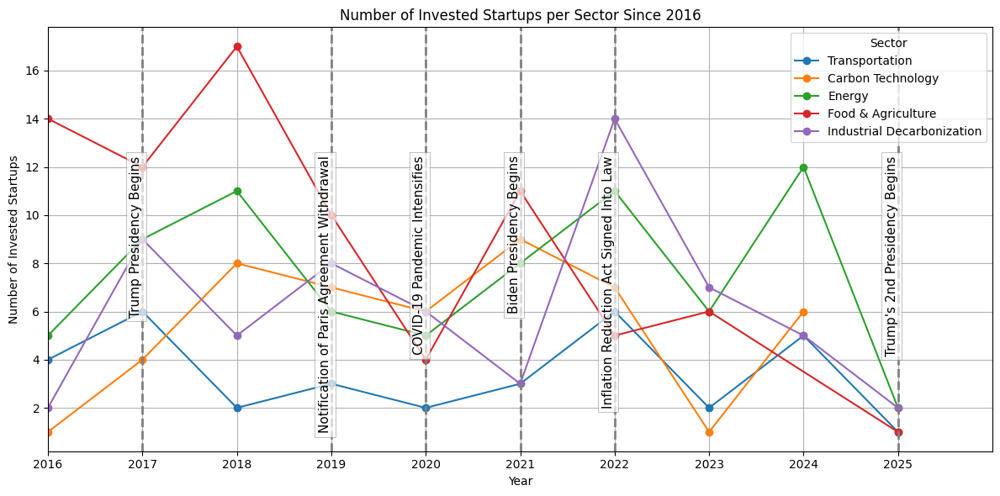
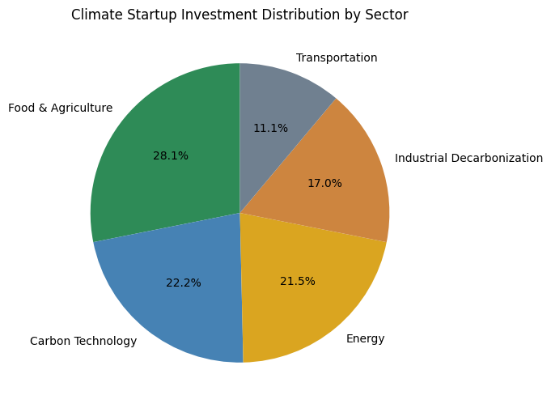

# Data Science Portfolio

## About Me

Welcome to my portfolio! I'm Brighten, a junior at Stanford University pursuing a B.S. in Data Science with a specialization in Mathematics and Computation. I'm passionate about human-centered technology, machine learning, and using data to solve meaningful real-world problems.

My experience spans data science, AI development, machine learning projects, and quantitative scientific research. Most recently, I worked as a Software Developer Intern at Kotozna in Tokyo, Japan, where I contributed to AI-powered automation, conversational AI, and backend development. I also have a background in astronomy research, including a first-author publication in the *Journal of Double Star Observations*.

Through my projects and experiences, I enjoy exploring how data and technology can be used to uncover insights, build intelligent systems, and create practical solutions.

#### Technical Skills
**Programming:** Python, SQL, R, C++  
**Data Science & Machine Learning:** pandas, NumPy, scikit-learn, data collection, web scraping, data wrangling, exploratory data analysis, visualization, natural language processing, classification, and recommendation systems  
**Development Tools:** Git, Docker, Playwright, AWS, REST APIs, GraphQL, Streamlit

[Resume](https://drive.google.com/file/d/1ETkWlXbYDxyKYa-zTUmalV-dn9tEgsgn/view)

## Work Experience

### Software Developer Intern | Kotozna
**Tokyo, Japan | June 2026 – August 2026**

During my ten-week internship at Kotozna, an AI technology company based in Tokyo, Japan, I worked on projects spanning AI-powered test automation, conversational AI development, and backend infrastructure. Working in an international startup environment gave me the opportunity to apply my technical skills to real-world problems while collaborating with developers and business teams.

**Key Projects & Contributions:**

- **AI-Powered Test Automation:** Developed an automated QA testing framework using Playwright, Stagehand, and Docker to reduce reliance on repetitive manual testing. Integrated an AI agent that allows nontechnical team members to create and execute browser-based tests through natural-language instructions, along with Slack notifications for failed tests.

- **Conversational AI Development:** Contributed to the development of AI Jota, a whiskey-focused conversational AI chatbot for Kirin. Created knowledge graphs across 40 whiskey-related domains, organized 80 knowledge categories, and refined the chatbot's conversational responses for clarity, humor, and naturalness.

- **Backend Development & Infrastructure:** Worked with AWS servers, SQL databases, GraphQL, REST APIs, and Git to configure development environments, manage database operations, and implement backend functionality.

- **Business Development:** Represented Kotozna at the IVS startup conference in Kyoto, collaborating with the sales team to pitch the company's AI products and engage with prospective clients.

This internship strengthened my experience in AI systems, software engineering, and collaborative problem-solving, while teaching me the importance of designing technology around the people who will actually use it.

### Student Researcher | University of Hawaiʻi Institute for Astronomy
**Pukalani, Hawaiʻi | June 2021 – August 2023**

As a student researcher at the University of Hawaiʻi Institute for Astronomy, I conducted quantitative astronomical research focused on analyzing observational data and investigating celestial objects.

My primary research project involved analyzing the consistency and precision of measurements of seven faint double-star pairs. This work culminated in a **first-author research paper published in the peer-reviewed *Journal of Double Star Observations*.**

I also worked on a separate research project investigating the color of NASA's Lucy spacecraft using calculations derived from observations taken through different astronomical filters.

These experiences introduced me to scientific research, quantitative analysis, and the process of translating observational data into meaningful conclusions. They also played an important role in developing my interest in data science and computational problem-solving.## Work Experience

### Software Developer Intern | Kotozna
**Tokyo, Japan | June 2026 – August 2026**

During my nine-week internship at Kotozna, an AI technology company based in Tokyo, Japan, I worked on projects spanning AI-powered test automation, conversational AI development, and backend infrastructure. Working in an international startup environment gave me the opportunity to apply my technical skills to real-world problems while collaborating with developers and business teams.

**Key Projects & Contributions:**

- **AI-Powered Test Automation:** Developed an automated QA testing framework using Playwright, Stagehand, and Docker to reduce reliance on repetitive manual testing. Integrated an AI agent that allows nontechnical team members to create and execute browser-based tests through natural-language instructions, along with Slack notifications for failed tests.

- **Conversational AI Development:** Contributed to the development of AI Jota, a whiskey-focused conversational AI chatbot for Kirin. Created knowledge graphs across 40 whiskey-related domains, organized 80 knowledge categories, and refined the chatbot's conversational responses for clarity, humor, and naturalness.

- **Backend Development & Infrastructure:** Worked with AWS servers, SQL databases, GraphQL, REST APIs, and Git to configure development environments, manage database operations, and implement backend functionality.

- **Business Development:** Represented Kotozna at the IVS startup conference in Kyoto, collaborating with the sales team to pitch the company's AI products and engage with prospective clients.

This internship strengthened my experience in AI systems, software engineering, and collaborative problem-solving, while teaching me the importance of designing technology around the people who will actually use it.

### Student Researcher | University of Hawaiʻi Institute for Astronomy
**Pukalani, Hawaiʻi | June 2021 – August 2023**

As a student researcher at the University of Hawaiʻi Institute for Astronomy, I conducted quantitative astronomical research focused on analyzing observational data and investigating celestial objects.

My primary research project involved analyzing the consistency and precision of measurements of seven faint double-star pairs. This work culminated in a **first-author research paper published in the peer-reviewed *Journal of Double Star Observations*.**

I also worked on a separate research project investigating the color of NASA's Lucy spacecraft using calculations derived from observations taken through different astronomical filters.

These experiences introduced me to scientific research, quantitative analysis, and the process of translating observational data into meaningful conclusions. They also played an important role in developing my interest in data science and computational problem-solving.

**Published Research Paper:**

📄 [Read My Paper — Journal of Double Star Observations (2023)](https://www.jdso.org/volume19/number2/Tantisira_175_182.pdf)

## Projects
### [Analyzing Investment Trends of Climate Tech Startups Since 2016](https://github.com/Boxipop/Investment-Trends-of-Climate-Tech-Startups-Since-2016)
As a final project for a data science class, I along with a partner analyzed investments trends of various climate tech startups since 2016. Some questions we set out to address were: How has the number of investments in different climate sector startups changed within the past three presidencies? What language commonly appears in each startup’s startup descriptions? Are there patterns in investment timing that correlate with major climate or policy events? Overall, startup investment peaked mid-presidency for both terms, with the energy sector increasingly gaining traction and the Food & Agriculture sector decreasing over time. For an in-depth explanation of the process and an analysis of the results (including visuals), please refer to our final project poster in the GitHub repository linked above.  

      

### [Anime Recommender](https://github.com/Boxipop/Anime-Recommender)
Built a full-stack machine learning [web application](https://anime-recommender-application.streamlit.app/) that uses **K-Nearest Neighbors (KNN)** to suggest anime based on user preferences. The model takes in an anime from the user and returns the top 10 most similar anime based off the following features: Demographics (e.g. Shonen), Themes (e.g. Time Travel), Genres (e.g. Action), Synopsis, Studio, and Anime Type (e.g. Series, Movie). All anime data was obtained through Jikan, an unofficial and open-source API for MyAnimeList (the world's most active online anime and manga community and database). For a full explanation and walkthrough of the entire process, please refer to the README file.

